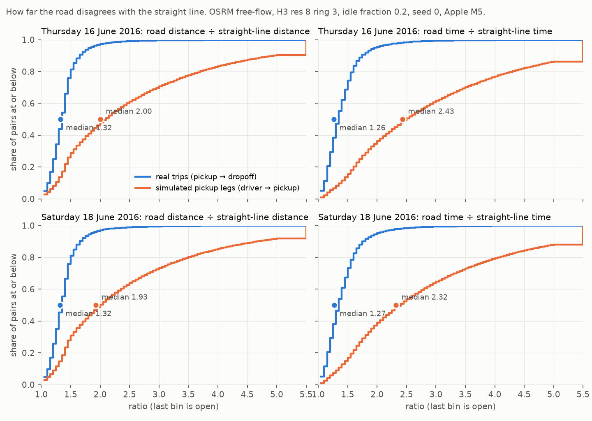
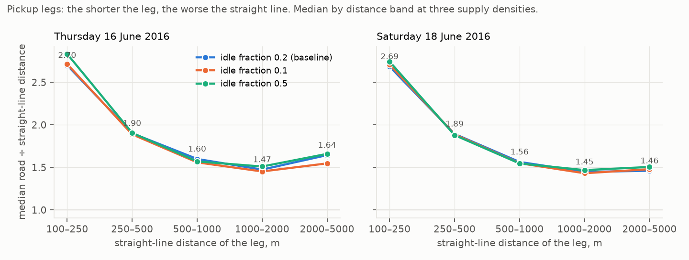
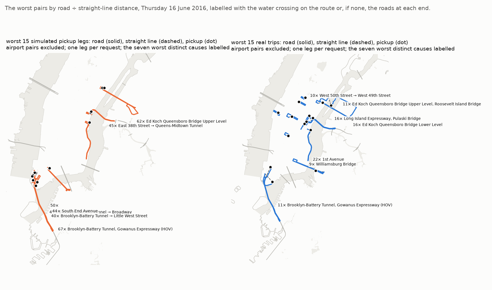
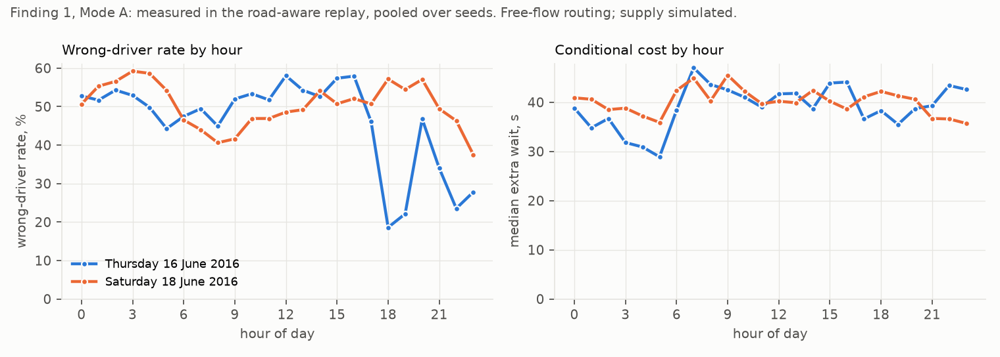
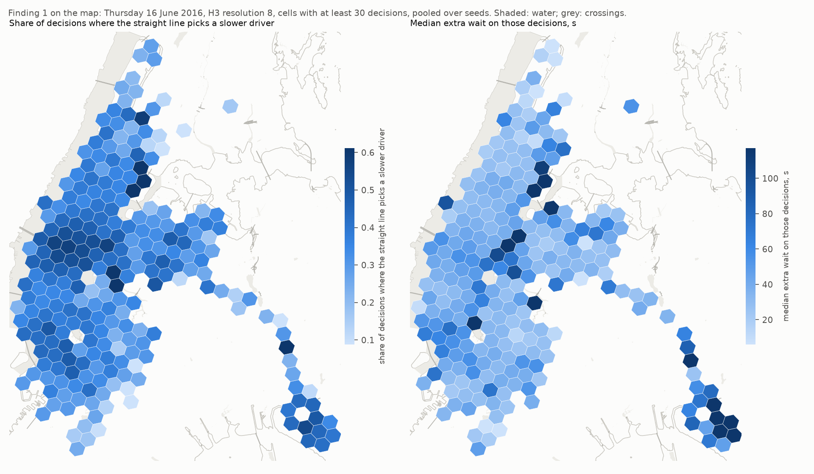
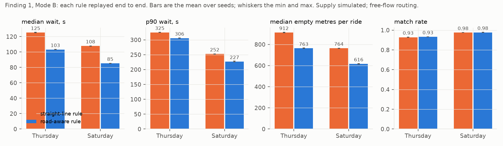
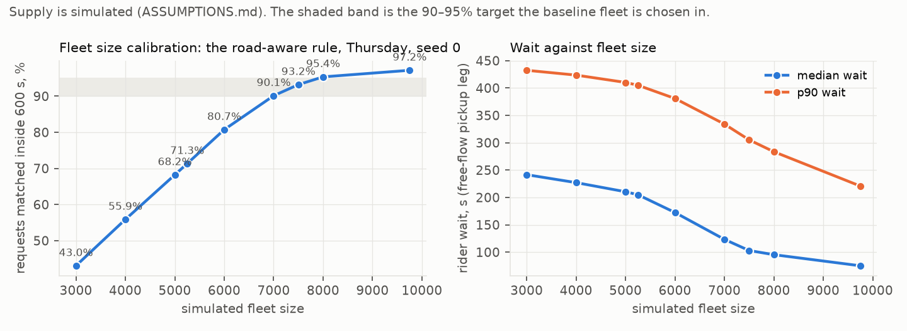
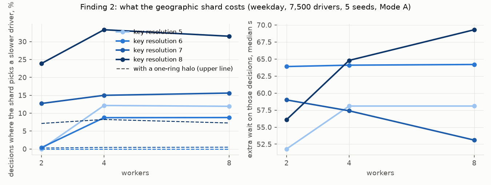
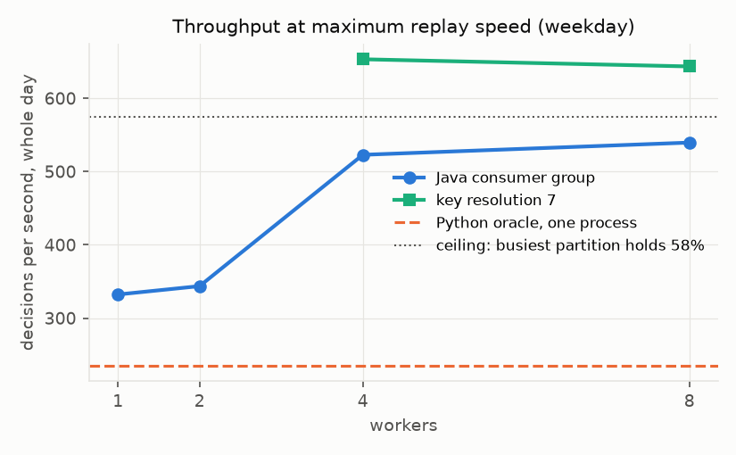
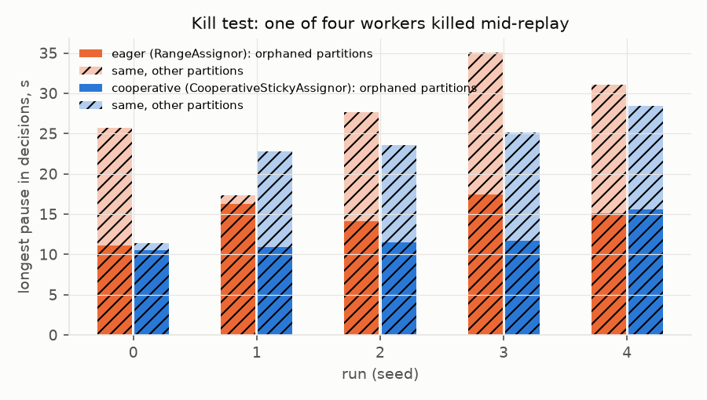

# Deadhead

A real-time ride-matching service built on a real day of New York taxi demand, routed on the real
road network, sharded by map cell across a Java consumer group, and measured under worker failure.
**Deadhead** is the industry term for a vehicle driving empty between rides; it is the cost the
two findings here are measured in.

**Status: Phase 3 complete — the matcher runs as a Java consumer group sharded by map cell, is
measured against the single-process oracle, and the geographic shard is priced at the level of the
decision; a worker is killed mid-day ten times and no rider or driver is ever matched twice.**
`SPEC.md` is the plan; `PREDICTION.md` holds the guesses written before each
measurement, with the outcome beside them; `NUMBERS.md` holds every figure with the file behind it;
`ASSUMPTIONS.md` is the supply model.

## Honest limits (read these first)

1. **The demand is real; the supply is simulated.** Trip records say when and where people were
   picked up. No public dataset says where idle drivers were, so drivers are a model
   (`ASSUMPTIONS.md`, from Phase 2).
2. **This is a public taxi log**, not any company's dispatch system. Nothing here is a claim about
   how anyone's marketplace performs.
3. **Riders in the data never cancel.** Abandonment is a modelled parameter.
4. **Free-flow routing is not live traffic** until Phase 5, and a calibration after it.
5. **Every number names its hardware and seed.** The lane so far is one laptop: Apple M5, 16 GB.
6. **One city.** New York's rivers make straight-line error unusually visible: the best case for
   that finding, not the typical one.
7. **A sharded replay on one machine is not a production system.**
8. **The map is ten years newer than the demand** (OpenStreetMap 2026-10-18; trips June 2016).

## What Phase 0 established

- **Coordinates.** The TLC's own trip files have been rewritten without pickup and dropoff
  coordinates for every year. NYC Open Data's copy of the 2016 file still has them. The week of
  13–19 June 2016 was pulled: 2,575,502 trips, 97.96% clean. The two study days are Thursday 16
  June (391,042 requests) and Saturday 18 June (362,824).
- **The road network.** 642,217 nodes and 756,257 edges behind OSRM. One route answers in about
  1 ms; one pickup against 50 candidate drivers in 6 ms. Routing per pair is affordable, so no
  hex-to-hex matrix is built.
- **Water crossings, computed not hand-picked.** 144 named bridges and tunnels whose road
  geometry crosses water, from the Verrazzano-Narrows to the Harlem River bridges.

## Phase 1 — how far the road disagrees with the straight line

**The supply side is simulated** (`ASSUMPTIONS.md`): an idle driver is a real dropoff from the
prior hour, thinned to a stated density. The demand side, the map, and every route are real.

Two kinds of pair were routed on the real road network and compared with the straight line between
their endpoints. All figures are in `NUMBERS.md`; the plots are in `figures/`.

- **Real trips** (40,000 per day, pickup to dropoff): the road is **1.32× the straight line at the
  median, 1.63× at the 90th percentile**, the same on a Thursday and a Saturday. A quarter of trips
  cross water, and those are barely worse (1.36 against 1.31). On a committed trip the river costs
  little.
- **Simulated pickup legs** (driver to pickup, the 50 nearest candidates by straight line for 6,000
  requests per day): the road is **2.0× the straight line at the median and 4.9× at the 90th
  percentile**. The leg a matcher compares is short, 270 m at the median, and short legs are where
  one-way streets, divided avenues and limited-access roads bite: **2.7× for legs under 250 m,
  1.9× for 250–500 m, 1.5× for 1–2 km.** Those per-band numbers hold when the supply density is
  halved or more than doubled; only the headline moves, because density sets the leg length.
- **The worst pairs are named, not hand-picked.** Outside the airports, the worst legs are drivers
  already inside a bridge or tunnel approach: a driver 122 m from a pickup but committed to the
  Brooklyn-Battery Tunnel is 8.2 km away by road (67×); the Queensboro Bridge upper level (62×),
  the Queens-Midtown Tunnel (46×) and the Williamsburg Bridge (54×) do the same. The worst trips
  start on one-way avenues. The airport terminal loops are worse than any street: a driver on
  JFK Terminal 4 Departures 103 m from a pickup is 8.9 km away by road.
- **The prediction was wrong.** `PREDICTION.md` guessed 1.35× for legs; the measurement is 2.0×.
  The guess for trips was close. The record stays.





**The routing layer** answers 3,500 routes per second and 2,000 one-to-50 tables per second from
eight Python threads against one OSRM container on the laptop. A day of 400,000 decisions is a few
minutes of routing. Per-pair routing stays; no hex-to-hex matrix.

## Phase 2 — the stream, the oracle, and Finding 1

**Supply is simulated** (`ASSUMPTIONS.md`): 7,500 drivers, starting at real dropoffs, idle at their
dropoff after each trip, cruising toward the previous hour's demand after five idle minutes. The
demand, the map and every route are real. The fleet size is a calibration: the smallest fleet at
which the road-aware rule matches 90–95% of the day inside a promised 600 s. **The model as first
written, with no repositioning, could not serve the day at any size tried**, and that failure is
recorded in `NUMBERS.md` alongside the baseline.

**What runs.** A day of demand is a Kafka topic with 8 partitions keyed by the pickup's coarse H3
cell. One Python consumer reads every partition, merges them into event-time order, keeps the fleet
in memory, and writes one record per decision to an `assignments` topic keyed by request id. Two
ranking rules sit behind one interface and rank the same candidate set, the 50 nearest idle drivers
by straight line within three hex rings: **straight-line** picks the nearest by air, **road-aware**
picks the nearest by road time. At every decision the matcher also records what the other rule
would have picked. It runs at 235 decisions per second, 4 ms per decision, a day in 28 minutes, and
the same seed gives byte-identical assignments twice. No request was matched twice and no driver
claimed twice in 28 replays. All figures below are five-seed means; the spread is in `NUMBERS.md`.

**Finding 1: what the straight-line shortcut costs, decision by decision.**

- On the weekday, the straight line picks a slower driver than the road in **44% of decisions**.
  On exactly those decisions the rider waits **40 s longer at the median and 130 s at the 90th
  percentile**, and the driver drives 237 m further empty.
- End to end (each rule replayed on its own), the road-aware rule cuts the median wait from
  **125 s to 103 s** and empty driving from **912 m to 763 m per ride**: 50,000 empty kilometres a
  day across the fleet. Match rates are the same within half a point.
- The straight-line rule's promised pickup time is missed on **94% of rides**, by 1.8× at the median.
- **Water is where the cost concentrates.** Straight-line picks whose route crosses a river are 3%
  of decisions and carry **a quarter of the total extra wait**: 157 s at the median against 38 s
  elsewhere. On the map the worst cells sit at the East River crossings and the RFK Bridge approach.
- **The rate depends on how dense supply is.** With 3,000 drivers it is 15%; with 9,750 it is 53%;
  in the evening peak, when the nearest driver is a kilometre away, it falls to about 20%. The
  conditional cost does not move: 35–45 s at the median in every hour and at every fleet size.
- The weekend repeats the weekday: 50% of decisions, 40 s median.
- **The prediction was wrong on the rate** (15% predicted) **and right on the water share.**






## Phase 3 — the service, sharded by map cell, and Finding 2

**What runs.** The matcher is a **Kafka consumer group in Java** (`consumer/`): N workers, each owning the
partitions the group assigns it, and with them the map cells whose key hashes there. The stream is keyed by
the pickup's coarse H3 cell (resolution 6, edge about 3 km), as the spec fixed, so that a worker owns
contiguous regions rather than a scatter of fine cells. A worker sees the idle drivers in its own cells and
no others. Driver state is a per-partition fold of a `fleet` log (versioned upserts and tombstones), so a
driver lives in exactly one worker's region and a killed worker's successor rebuilds its region from the log.
A match is durable in order (departure, decision, arrival and assignment, then the offset), consumption is
at-least-once, and the decided-request set in the fold makes redelivery idempotent: a successor re-emits, it
never re-decides. The workers carry no geospatial library: every cell table they need (parents, rings,
demand points, the partition map) is precomputed in Python and exported as JSON. Across workers, event time
is held together by a shared clock topic: at maximum replay speed no worker runs more than 30 s of event
time ahead of the slowest live one; at ×1 the wall clock does it. Failure detection is set to a 6 s session
timeout, stated with every number, because the client's 45 s default would be what the kill test measured.

**The oracle is the judge.** The Phase 2 matcher, with its cruise point made deterministic so that a worker
in another language draws the same one, is replayed again (five weekday seeds, one weekend) and the service
is compared to it request by request. **At one worker the service is the oracle's mirror: the same status
and the same driver on all 391,042 requests.** Every difference at more workers is the shard's.

**Finding 2: what the geographic shard costs, decision by decision.** Paired, like Finding 1: at every
decision the oracle records what a worker that could see only its own region would have picked.

- With **4 workers at resolution 6**, the shard picks a slower driver on **8.7% of decisions** and has **no
  visible driver at all on another 4.0%**, on a weekday with 7,500 drivers. On the slower picks the rider
  waits **64 s longer at the median, 252 s at p90**; the day loses 923 rider-hours. The weekend is 7.9%
  and 2.0%, 47 s. Eight workers cost the same as four: the three partitions that carry 96% of the day are
  already apart.
- **The cheap shard cannot balance.** Keyed at resolution 6, one Midtown cell is half the weekday and one
  partition 58% of it; the busiest-partition ceiling is 1.73× one worker. Keyed finer, the hash scatters
  neighbours: at resolution 8 the shard sees 5 of 50 candidates and picks a slower driver on **33%** of
  decisions. There is no resolution at which the key both balances and keeps the candidates: that is the
  finding.
- A one-ring **halo** of neighbouring cells' drivers, built only as the upper line, removes all of the cost
  at resolution 6 and 7 and three quarters of it at resolution 8.
- End to end the service matches **89.3% of the weekday against the oracle's 93.3%** at 4 workers: the
  riders it drops are the ones whose only close driver was across an edge. The survivors' median wait
  *falls* (93 s against 103 s), by selection. A dashboard would show the shard as an improvement.
- The cost is highest in the evening: 11–15% of decisions from 18:00, 85–116 s at the median.

**Throughput, on this one machine** (Apple M5, broker, router and workers all local). One Java worker does
**332 decisions/s** against the Python oracle's 235, **1.41×**, and the decision is 3 ms against 4 ms: the
routing call is the decision, as predicted, and the compiled consumer is not the point. The group scales with
the key's balance, not the worker count: 4 workers reach 523/s (1.57×, under the 1.73× ceiling), 8 add
nothing, and the finer key that balances better (653/s at resolution 7) pays for it in Finding 2. A full
weekday replays in 12.5 minutes at 4 workers against 28 for the oracle. At ×1, in the evening peak, a
request is decided **18 ms after it is due at the median, 63 ms at p99**, end to end through the poll, the
fleet log and the routing call.

**The kill test.** The worker owning the Midtown partition is killed with SIGKILL at a stated minute of
the morning, five seeds under the eager assignor and five under the cooperative one, and the result is
checked against the oracle's request set and the fleet log. **In all ten runs no request was matched twice
and no driver was claimed twice**; every request was decided exactly once, every driver was in exactly one
region after the kill, and the 16–204 records redelivered after each kill were re-emitted identically. The
successor takes over **6–7.5 s after the kill under both assignors**: the 6 s session timeout is the floor,
and a kill is a missed heartbeat that no assignor detects sooner. Cooperative rebalancing saves the work
after detection (2 s of refolding against 7–8 s, because the eager rebalance makes every worker rebuild),
not the detection. Delayed requests number 54–91 per run and wait 10–18 s longer at the median, bounded by
the 30 s event-time slack. **The prediction's bug did not happen**: the first kill run found three other
things (`BUGS.md` #5–#7), and the claim-before-decide order held on the first try.





## Prior art, by name

Road-network ride-sharing simulators exist and are good: **AMoD2**, a deep-RL taxi dispatcher,
**tsharesim**. The cost of straight-line distance on a committed route is published by **nextmv**
(Haversine vs. OSRM). **Grab**'s engineering blog and **HyperTrack**'s product both rank drivers by
road ETA for exactly the reason this project measures. **EasyRide** and **TaxiOptimizer** stream
NYC taxi data through Kafka. What is built and measured here that is not there: the combination,
as a sharded service on real demand, with a kill test checked against an oracle, and two
approximations priced at the level of the decision.

## Reproduce Phase 0

```bash
uv sync --extra dev
brew install osmium-tool
curl -o data/osm/new-york-latest.osm.pbf https://download.geofabrik.de/north-america/us/new-york-latest.osm.pbf
scripts/osm_clip.sh && scripts/osm_prepare.sh && scripts/osrm_build.sh
docker compose up -d osrm
.venv/bin/python -m deadhead.fetch_opendata 2016-06-13 2016-06-19 data/tlc/opendata
.venv/bin/python -m deadhead.phase0_data data/tlc/opendata results/phase0
.venv/bin/python -m deadhead.phase0_crossings data/osm results/phase0
.venv/bin/python -m deadhead.phase0_osrm data/tlc/opendata/yellow_2016-06-16.parquet results/phase0
.venv/bin/python -m pytest -q
```

## Reproduce Phase 2

```bash
docker compose up -d kafka
.venv/bin/python -m deadhead.stream configs/phase2.yaml                 # both days into Kafka, ~3 s
.venv/bin/python -m deadhead.oracle configs/phase2.yaml --day 2016-06-16 --rule road --seed 0   # one replay, ~28 min
scripts/phase2_runs.sh 7500                                              # all 28 replays, ~3 h on one laptop
.venv/bin/python -m deadhead.phase2_metrics configs/phase2.yaml
.venv/bin/python -m deadhead.figures results figures
.venv/bin/python -m pytest -q
```

## Reproduce Phase 3

```bash
docker compose up -d                                          # the broker's listener list changed since Phase 2: a recreated broker is empty, and the next line refills it
.venv/bin/python -m deadhead.phase3_data configs/phase3.yaml  # cell, demand, fleet and partition tables for the workers; re-produces the request topics, ~10 s
(cd consumer && gradle jar)                                   # Java 21, Gradle 9 -> consumer/build/libs/deadhead-consumer.jar
scripts/phase3_oracle_runs.sh                                 # the reference ledgers, six replays three at a time, ~70 min
.venv/bin/python -m deadhead.phase3_service configs/phase3.yaml --day 2016-06-16 --workers 4   # one service run, ~13 min
scripts/phase3_runs.sh                                        # every measurement run, ~3.5 h; kill runs: scripts/phase3_runs.sh kill
.venv/bin/python -m deadhead.phase3_metrics configs/phase3.yaml
.venv/bin/python -m pytest -q
```

## Reproduce Phase 4

```bash
scripts/phase4_runs.sh sweep                                  # the batched oracle over W, weekday, seed 0: six replays three at a time, ~2.5 h
OP=10 scripts/phase4_runs.sh operating radius weekend service # the operating point over seeds and without rolling, the radius, the weekend, the service with the window
.venv/bin/python -m deadhead.batch configs/phase4.yaml --day 2016-06-16 --window 10              # one batched replay, ~1 h
.venv/bin/python -m deadhead.phase3_service configs/phase4.yaml --day 2016-06-16 --workers 4 --window 10   # the service with a 10 s window
.venv/bin/python -m deadhead.phase4_metrics configs/phase4.yaml
.venv/bin/python -m pytest -q
```

## Reproduce Phase 5

```bash
.venv/bin/python -m deadhead.phase5_speeds configs/phase5.yaml    # the calibration from the trip data and the Phase 1 routed trips, ~2 s
scripts/phase5_runs.sh                                            # the calibrated replays (weekday seeds 0-4, weekend) and one free-flow replay, ~1.5 h
.venv/bin/python -m deadhead.phase5_metrics configs/phase5.yaml
.venv/bin/python -m pytest -q
```

## Reproduce Phase 1

```bash
.venv/bin/python -m deadhead.phase1_disagreement configs/phase1.yaml   # ~2 min; writes results/phase1 and data/phase1
.venv/bin/python -m deadhead.figures results figures
.venv/bin/python -m pytest -q
```
